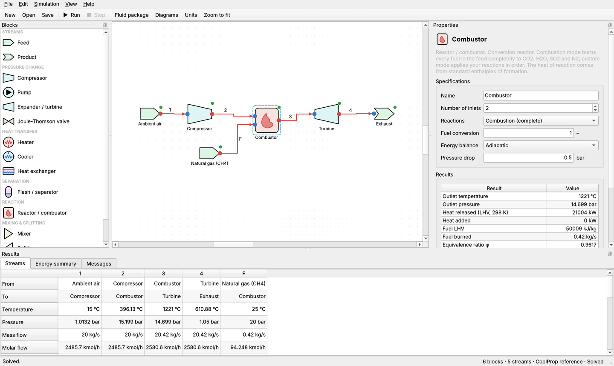

# ThermoSolveDP

*Created by Deoras Prabhudharwadkar*

A desktop application for modelling steady-state thermodynamic processes. You draw a flowsheet by dragging blocks onto a canvas and connecting them with streams. ThermoSolveDP then solves the mass and energy balances with fluid properties from [CoolProp](http://www.coolprop.org/), and reports stream conditions, duties, power and cycle performance, with T–s, P–h and heat-exchanger T–Q diagrams.



It runs on **macOS** (Apple Silicon and Intel) and **Windows**, and also on Linux, from the same source code. It is free and open source under the [MIT license](LICENSE).

## Download

Ready-made apps, which need nothing else installed, are on the **Releases** page of this repository (and on the project website):

| File | For |
|---|---|
| `ThermoSolveDP-macOS-AppleSilicon.zip` | Macs with M1–M4 chips. Unzip and drag ThermoSolveDP.app into Applications. |
| `ThermoSolveDP-macOS-Intel.zip` | Macs with Intel processors |
| `ThermoSolveDP-Windows.zip` | Windows 10/11, 64-bit. Unzip and run `ThermoSolveDP.exe`; keep the folder together. |
| `ThermoSolveDP-source.zip` | The Python source package, for any platform (see below) |

The apps are not signed with a paid Apple or Microsoft certificate, so the first time you open them:
- **Mac:** if macOS says it *could not verify* ThermoSolveDP, click Done, open System Settings ▸ Privacy & Security, and click **Open Anyway**.
- **Windows:** if *Windows protected your PC* appears, click **More info**, then **Run anyway**.

## Install and run from source

You need **Python 3.10–3.13**. Get it from [python.org](https://www.python.org/downloads/). On Windows, tick *Add python.exe to PATH* in the installer.

**Quickest way.** The first launch creates a private environment in `.venv` and installs the dependencies, which takes a minute or two. Later launches are instant.

| Platform | Launch |
|---|---|
| Windows | Double-click `run_windows.bat` |
| macOS | Double-click `run_mac.command`. If macOS says it *could not verify* the file, open Terminal, type `bash` followed by a space, drag `run_mac.command` into the window, and press Return. Running `xattr -dr com.apple.quarantine` followed by the folder path removes the warning for good. For a proper Mac app, see *Making a Mac app* below. |

**Manual setup**, which is the same on both platforms:

```bash
python3 -m venv .venv                 # Windows: py -3 -m venv .venv
source .venv/bin/activate             # Windows: .venv\Scripts\activate
pip install -r requirements.txt
python main.py                        # optionally: python main.py my_flowsheet.tpf
```

## Using it

1. **File ▸ Open example** loads one of the ready-made flowsheets. A good place to start is the *Linde-Hampson nitrogen liquefier*, which has a recycle loop.
2. Add blocks by dragging them from the **Blocks** palette, or double-clicking them.
3. Connect blocks by dragging from a **red outlet port** to a **blue inlet port**. You can also drag in the opposite direction.
4. Select a block to set its specifications in the **Properties** panel. Select a stream to rename it, mark it as a tear stream, or give it an initial estimate.
5. Press **Run** (F5). Block status dots turn green for OK, amber for a warning or red for an error. Streams are colored by phase: blue for liquid, purple for two-phase and red for vapor. Hover over a block or stream to see its results.
6. Results appear in the bottom panel:
   - **Streams**: the full stream table, exportable to CSV.
   - **Energy summary**: work and heat by block, net power, efficiency or COP, and mass and energy balance checks.
   - **Messages**: the solver log, including warnings.
7. **Export results** (File ▸ Export results) saves CSV files that open in Excel or Numbers. They are written in the current display units, with numbers as plain numbers and units in their own column:
   - **Stream table**: one column per stream, with conditions, phase, properties and mixture mole fractions.
   - **Block results**: one row per item. Each block's specifications, results, work and heat, and any warnings.
   - **Energy summary**: work and heat by block, flowsheet totals (net power, efficiency or COP, balance checks) and the property method.
   - **All three** (⌘/Ctrl + Shift + E): writes `name_streams.csv`, `name_blocks.csv` and `name_energy.csv` in one step.

   You can also select cells in any results table and press ⌘/Ctrl + C to paste them into a spreadsheet.
8. **Diagrams** (Ctrl/⌘ + D) shows T–s and P–h diagrams with the saturation dome and process paths, plus the T–Q profile of each heat exchanger.

Canvas controls:
- Ctrl/⌘ + scroll to zoom; middle-drag or Alt-drag to pan.
- Delete or Backspace removes the selection. **F** flips a block horizontally, which helps when drawing recycles.
- Right-click a block or stream to rename, flip, delete or tear it.

Display units (°C/K/°F; bar/kPa/MPa/psi/atm; kg/s, kg/h, t/h, lb/h; W/kW/MW) are set under **View ▸ Units**. Internally everything is SI, so switching units never changes the model.

## Blocks

| Block | Specifications | Notes |
|---|---|---|
| **Feed** | Fluid; T & P, P & vapor fraction, or T & vapor fraction; mass flow | Pure fluids such as `Water`, `R134a` or `N2`, or mixtures such as `Methane[0.9]&Ethane[0.1]` (mole fractions). The *Mixture…* button opens an editor. |
| **Product** | – | Marks the end of a stream. |
| **Compressor** | Outlet P or pressure ratio; isentropic efficiency | Adiabatic. Warns if the inlet contains liquid. |
| **Pump** | Outlet P or pressure ratio; isentropic efficiency | Warns if the inlet is not fully liquid. |
| **Expander / turbine** | Outlet P or pressure ratio; isentropic efficiency | Warns about wet expansion (vapor fraction < 0.88). |
| **Joule-Thomson valve** | Outlet P or pressure drop | Isenthalpic. Reports the mean JT coefficient. |
| **Heater / Cooler** | Outlet T, duty, outlet vapor fraction, or temperature change; pressure drop | Warns if the computed duty has the wrong sign. |
| **Heat exchanger** | Minimum approach ΔT, hot or cold outlet T, duty, or UA; pressure drop per side | Two-stream counter-current. The T–Q profile is checked in segments, so internal pinches and temperature crosses are caught. Reports UA, LMTD and effectiveness. |
| **Flash / separator** | Adiabatic or specified T; pressure drop | Splits into equilibrium vapor (top port) and liquid (bottom port). Mixtures get proper phase compositions from CoolProp. |
| **Reactor / combustor** | 1–4 inlets (e.g. air + fuel); *Combustion*: complete burnout of every fuel with a fuel-conversion setting, or *Custom reactions*: typed reactions with conversions; energy: adiabatic, outlet temperature or heat duty; pressure drop | Heat of reaction from standard enthalpies of formation. Reports outlet temperature, heat released (LHV basis), fuel LHV, equivalence ratio φ, excess air and outlet composition. See *Reactions* below. |
| **Mixer** | 2–6 inlets; outlet P = lowest inlet P or specified | Mixes different fluids by composition. Unconnected inlets are ignored. |
| **Splitter** | 2–6 outlets; split fractions or branch mass flows | The last outlet takes the remainder. |

## Fluid packages (property methods)

**Simulation ▸ Fluid package** chooses how properties are calculated:

| Method | Best for | Notes |
|---|---|---|
| **CoolProp reference** (default) | Pure fluids, and mixtures CoolProp has fitted data for (natural gas, air components, common refrigerant blends) | Most accurate. Fails if any component pair has no mixing data. |
| **Peng-Robinson** / **SRK** | Mixtures with missing pair data, e.g. mixed-refrigerant cycles with argon, R14 and HFCs | Fast and robust. Bubble points always work. Accuracy depends on k_ij. |

For the cubic equations, the dialog lists every component pair in the flowsheet with its binary interaction parameter **k_ij** and where it came from:

- **Fitted to CoolProp reference mixture**: done automatically when CoolProp has a fitted mixture model for the pair. k_ij is fitted to its bubble pressures at three compositions.
- **User value**: type a value in the table, or **Import CSV** with lines `component1, component2, kij`. User values are saved in the `.tpf` file.
- **No data – assumed 0**: shown in orange. Every run also lists these pairs as a warning, because k_ij = 0 can be badly wrong for strongly non-ideal pairs. In tests, R23/R14 with k_ij = 0 was 30% off in bubble pressure, against a fitted k_ij of 0.114. Enter literature values for these pairs where you can.

With a cubic equation, air is always written as N₂/O₂/Ar, since CoolProp's cubic library has no pseudo-pure air. Liquid densities from PR/SRK can be 5–15% off; this barely affects energy balances.

## Reactions

The **Reactor / combustor** block is a *conversion* reactor: you state how far each reaction goes, and ThermoSolveDP does the element and energy balance.

- **Combustion (complete)** finds every fuel in the feed and burns it completely, with `CxHyOzNwSv + (x + y/4 + v − z/2) O2 → x CO2 + y/2 H2O + v SO2 + w/2 N2`. Fuels include methane, ethane, propane, butanes, hydrogen, CO, alcohols, ammonia and H₂S. The *Fuel conversion* setting burns only part of each fuel. If there isn't enough O₂ (a fuel-rich feed), the burned fraction is limited by O₂ and a warning is shown.
- **Custom reactions** are typed one per line and applied in order:
  ```
  CH4 + 1.5 O2 -> CO + 2 H2O ; X=1 ; key=CH4
  CO + 0.5 O2 -> CO2 ; X=0.99
  ```
  `X` is the conversion of the `key` reactant. It defaults to 1, and the key defaults to the first reactant. Species can be formulas (CH4, O2, H2O, C3H8…) or CoolProp names. Every reaction is checked for element balance using CoolProp's molecular formulas.
- **Energy**: enthalpies are put on a *formation basis*. Each species gets its standard ideal-gas enthalpy of formation at 298.15 K (NIST / JANAF), tied to the active property model's reference state. The heat of reaction therefore comes out exactly, and the flowsheet energy balance closes.
- **Validation:** methane LHV comes out at 50.01 MJ/kg. The gas-turbine combustor outlet temperature is within 1.6 K of Cantera (NASA polynomials) for the same inlets.

Gas-turbine performance appears in the Energy summary as *Thermal efficiency (net work / fuel LHV)* and *Heat rate*.

## How the solver works

ThermoSolveDP's solver engine, **Thermosolve1.0**, is a **sequential-modular** steady-state solver:

1. It checks that every required inlet is connected.
2. It finds recycle loops (strongly connected components of the block graph) and picks **tear streams** to break them. Streams you mark as tears are used first, then streams with an estimate, then streams entering a mixer.
3. It calculates the blocks in topological order and iterates on the tear streams (mass flow, enthalpy, pressure and composition) until the relative change is below the tolerance.

Three convergence methods are available under **Simulation ▸ Solver settings**:

- **Broyden** (default) updates all tear variables together with a quasi-Newton step, so it handles strongly coupled loops. The Linde liquefier converges in about 30 iterations. Direct substitution actually diverges on that loop, because the linearized recycle map has an eigenvalue near −2.
- **Wegstein** accelerates each variable separately. It is allowed to *damp* oscillations as well as accelerate.
- **Direct substitution** is the most conservative.

If an accelerated step lands somewhere infeasible, for example a temperature cross in a heat exchanger, the solver backs off towards the last good point instead of failing.

**Closed cycles** with no feed (Rankine, refrigeration) need one stream with an **initial estimate**, because that estimate sets the circulating flow. Select the stream and tick *Initial estimate*. The examples show how.

## Examples and validation

| Example | What it shows |
|---|---|
| Rankine steam cycle | Closed cycle with an estimate. η = 34.0 %. Wet-expansion warning. |
| Vapor-compression refrigeration (R134a) | Cooling COP ≈ 3.1 |
| Linde-Hampson nitrogen liquefier | Two coupled recycle loops, heat exchanger with a pinch spec. About 6.9 % liquid yield per pass. |
| Natural gas JT + flash | Ternary mixture: chiller, JT valve and separator with vapor/liquid compositions |
| Gas turbine with methane combustor | Air compressor (pressure ratio 15), combustor with complete CH₄ combustion, turbine. TIT ≈ 1221 °C, LHV efficiency ≈ 36 %. |
| Mixed-refrigerant JT cryocooler | 7-component R245fa/R227ea/R125/R32/R23/R14/Ar mixture with Peng-Robinson. Closed cycle, recuperator with a pinch spec, and a load at −100 °C. The composition is illustrative, and 13 of the 21 k_ij values are flagged as assumed. |

The test suite checks each block against direct CoolProp hand calculations. That includes isentropic efficiency definitions, valve enthalpy, heat-exchanger balance and approach, and flash component balances. It also checks the Rankine efficiency against a hand calculation to 1e-6, recycle mass and energy balance closure, and save/load. A headless GUI smoke test opens and solves every example.

```bash
pip install pytest
python -m pytest tests
```

## Limitations

- Steady state only. There is no dynamic simulation.
- Heat exchangers are two-stream and counter-current. Multi-stream (LNG-style) exchangers are not included.
- Compressors, pumps and expanders are adiabatic with an isentropic efficiency. There is no polytropic efficiency or motor efficiency.
- **Air in mixtures.** CoolProp's `Air` is a *pseudo-pure* fluid (one fictitious substance), so it has no mixing data. ThermoSolveDP therefore writes air as N₂ 0.7812 / O₂ 0.2096 / Ar 0.0092 whenever it is mixed with something else, whether in a feed such as `Air[0.92]&CarbonDioxide[0.08]` or in a mixer. It also re-bases enthalpies so the energy balance stays consistent. Pure `Air` streams keep using the faster pseudo-pure model. Other pseudo-pure blends (R404A, R407C, R410A, R507A) cannot be mixed; enter their real components instead.
- **Reactions** are conversion-based, with no chemical equilibrium. Dissociation (CO, H₂, OH, NO) is not predicted, which is accurate for lean gas-turbine combustors (Cantera's full equilibrium differs by under 1 K at 1220 °C). Near-stoichiometric flames above about 1900 K would be overestimated. CoolProp's property models end at 2000 K, and the reactor warns above that. Formation enthalpies are tabulated for common fuels and combustion species; other species can take part only as inerts.
- **Mixture speed.** Mixture flashes cost milliseconds to about a second, compared with microseconds for pure fluids. ThermoSolveDP limits the impact in two ways:
  - Heat-exchanger profiles for mixtures are interpolated from a tabulated h(T) curve per side, which includes the exact bubble and dew points.
  - Cubic-EOS enthalpy and entropy flashes iterate on fast temperature-pressure flashes.

  The 7-component mixed-refrigerant example solves in about 20 s.
- Compressor and expander paths on the T–s and P–h diagrams are illustrative curves between the true end states.
- There is no undo/redo yet. Save often.

## Making a Mac app (ThermoSolveDP.app)

This turns your installed copy into a normal Mac application. It gets its own icon, runs without a Terminal window, appears in Applications, Launchpad and Spotlight, and opens `.tpf` flowsheets when you double-click them. You do it once, on your Mac:

1. Open **Terminal**, type `bash` followed by a space, drag **`build_mac_app.command`** from the ThermoSolveDP folder into the window, and press Return.
2. Wait 3–5 minutes. The script packages the app with PyInstaller and then **self-tests** it by solving every built-in example. It finishes with `SELFTEST PASSED` and opens a Finder window showing **ThermoSolveDP.app**.
3. Drag **ThermoSolveDP.app** into your **Applications** folder.

From then on, open ThermoSolveDP like any other app. To keep it in the Dock, right-click its Dock icon while it is running and choose Options ▸ Keep in Dock.

Notes:
- The app is self-contained, about 250–400 MB, with its own Python, CoolProp and Qt. It no longer needs the ThermoSolveDP folder, but keep the folder so you can rebuild after updates.
- Because the app is built on your own Mac, macOS does not show the "could not verify" warning for it.
- After an update, unzip the new version, run `build_mac_app.command` again, and replace the app in Applications.

**Windows:** `build_windows_exe.bat` does the same on a PC and creates `dist\ThermoSolveDP\ThermoSolveDP.exe`. Keep the whole `dist\ThermoSolveDP` folder together.

## License

ThermoSolveDP is released under the [MIT license](LICENSE), © 2026 Deoras Prabhudharwadkar. It uses CoolProp (MIT), Qt for Python / PySide6 (LGPL v3), matplotlib and NumPy; see [THIRD_PARTY_NOTICES.txt](THIRD_PARTY_NOTICES.txt).

## Project layout

```
main.py                    application entry point
thermosolvedp/
  engine/                  pure-Python thermodynamics (no GUI imports)
    thermo.py              CoolProp wrapper: Fluid, State, flash(), saturation dome
    material.py            stream state (fluid + flow + state)
    unitops.py             all blocks
    flowsheet.py           blocks + streams, save/load (.tpf = JSON)
    solver.py              tearing, ordering, Broyden/Wegstein convergence, summary
    export.py              CSV export of streams, block results and energy summary
    units.py               display-unit conversion
  gui/                     PySide6 interface (canvas, panels, plots, dialogs)
  examples.py              example flowsheets (python -m thermosolvedp.examples writes the .tpf files)
examples/                  the example flowsheets as .tpf files
packaging/                 PyInstaller recipe and app icons (used by build_mac_app.command / build_windows_exe.bat)
docs/                      project website (GitHub Pages) and screenshots
.github/workflows/         automatic tests, and Mac/Windows app builds for each GitHub release
tests/                     engine tests and a headless GUI smoke test
```

Because the engine has no GUI dependencies, you can script it directly:

```python
from thermosolvedp.engine import Flowsheet, solve
fs = Flowsheet.load("examples/rankine_cycle.tpf")
report = solve(fs)
print(report.converged, [(r.label, r.value) for r in report.summary])
```

To add a new block, subclass `UnitOp` in `unitops.py`, declare its `PARAMS` and ports, implement `calculate()`, and register it in `BLOCK_TYPES`. Then give it an icon in `gui/icons.py` and a size in `gui/geometry.py`.
